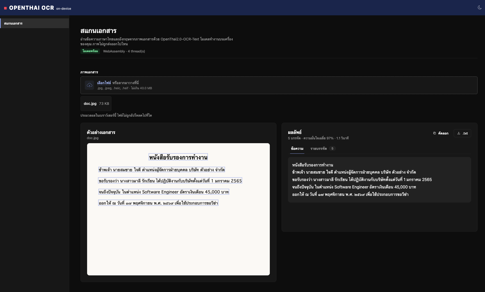

# ocr-service

Thai + English document OCR that runs entirely in the browser:
[OpenThai2.1-OCR-Text](https://huggingface.co/iapp/OpenThai2.1-OCR-Text-20261118) on ONNX Runtime Web, no
server, files never leave the machine. Accepts `.jpg` and `.HEIC`.

**Live demo: <https://openthai-ocr-text-demo.pages.dev>**



The app lives in [`apps/web`](apps/web) (see its README for how it works and how to deploy).

Bun-workspace monorepo scaffolded by [`bank20baht-cli`](https://github.com/bank20baht/bahtui)
(`bahtui new`): apps under `apps/*`, shared libraries under `packages/*`.

## Quickstart

```sh
bun install
bun run dev        # runs every apps/*/package.json "dev" script in parallel
bun run check      # lint + format:check + knip + typecheck (also the pre-push hook)
```

## Layout

```
apps/<name>          runnable applications (each with its own package.json)
packages/<name>      shared libraries consumed by apps via workspace:*
scripts/dev.ts       parallel dev runner with prefixed output (apps/* only)
scripts/each.ts      `bun run scripts/each.ts <script>` in every workspace that has it
```

Add a workspace by creating `apps/<name>/package.json` (or `packages/<name>`)
with `dev`, `build` and `typecheck` scripts, then extend `knip.ts` with a
matching workspace entry so dead-code checks cover it.

## Toolchain

- **ESLint 10 + typescript-eslint** (`eslint.config.ts`), **Prettier** (no semi,
  single quotes, width 100), **knip** — all run by `bun run check`. Their config comes from
  `bank20baht-strict`: bump it to take rule updates (Renovate does this); put app overrides
  last, each with a reason.
- **husky** hooks: `pre-commit` → lint-staged, `commit-msg` → commitlint
  (Conventional Commits), `pre-push` → `bun run check`.
- `tsconfig.base.json` — extends `bank20baht-strict/tsconfig/base.json` (strict,
  `verbatimModuleSyntax`, `noUncheckedIndexedAccess`, `exactOptionalPropertyTypes`, ...).
  Extend it from each workspace's `tsconfig.json`.
